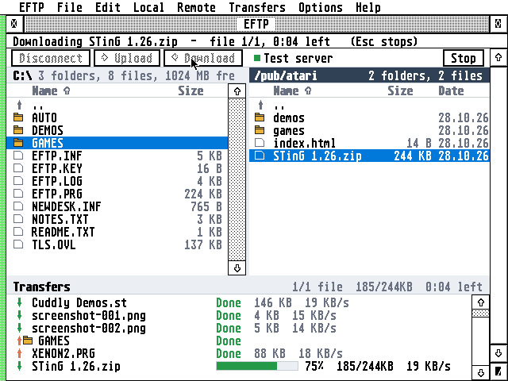

# EFTP


A two-pane FTP program for the Atari, written in C for GEM, that reaches FTPS and SFTP servers too.

**Runs on** any ST, STE, TT or Falcon with TOS 1.04 or newer, EmuTOS, MagiC or MiNT, in 640×200 or
larger, with about 350 KB free (a 1 MB ST with STinG will do), and STinG, STiK, MiNTnet or MagiC-Net.

**Highlights**

- **Two panes:** this Atari on the left, the server on the right, the transfers below.
- **Drag and drop** across, double-click, or Upload and Download in the toolbar.
- **Whole folders both ways**, listed in full before the first file goes.
- **A transfer queue** with the speed and the time left, and why a file failed.
- **Resume:** Stop and Retry go on where a file stopped; a dropped line reconnects.
- **Names TOS can take:** long names come down as 8+3; dates kept; text by its extension.
- **FTPS and SFTP:** through AERA-Gateway from any Atari, or FTPS by a TT or Falcon itself.
- **A Site Manager** with encrypted passwords, and Quick connect for the others.
- **File management on both sides:** new folder, rename, delete, permissions on the server.
- **Small:** one program for every Atari, about 250 KB, that runs on a 1 MB ST with STinG.



## Getting started

Download the **[latest release](https://github.com/whomper/EFTP/releases/latest)**:

| File | What it is |
|---|---|
| `EFTP.PRG` | the program, for every Atari |
| `EFTP.HYP` | the guide, for EHypView or ST-Guide (the Help key) |
| `TLS.OVL`, `CACERT.PEM`, `ROOTS.DAT` | FTPS on a TT or Falcon itself (a Direct connection) |
| `EFTP.RSC`, `EFTPNV.RSC`, `EFTP.ICN`, `EFTPMK.ICN` | the desktop icon (`EFTPNV.RSC` under NVDI's own palette) |

1. Copy `EFTP.PRG` and `EFTP.HYP` (and on a TT or Falcon the TLS files) into a folder of their own.
2. Load STinG, or run MiNT with MiNTnet.
3. Start EFTP, choose **File > Sites** (^K), make a site and press **Connect**.
4. Press **Help** for the guide.

Under TOS use `FOLDR100.PRG` ([why](docs/GUIDE.md#what-you-need)); set STinG's Delay for the machine
([how](docs/GUIDE.md#when-something-goes-wrong)).

## How it reaches the servers

Plain FTP goes straight from the Atari to the server. For FTPS and SFTP, EFTP can go through
[AERA-Gateway](https://github.com/whomper/AERA-Gateway), the family's gateway on a Raspberry Pi on
your home network: the Atari speaks plain FTP to the Pi, and the Pi speaks FTPS or SFTP to the
server. It is optional for FTPS on a TT or Falcon, which can make the connection itself (a Direct
connection); an ST, and SFTP from any Atari, need it. How to set it up is in the
[Gateway's README](https://github.com/whomper/AERA-Gateway#readme).

## Building

```sh
sudo apt install gcc-m68k-linux-gnu python3 zip   # no MiNTLib needed
make                         # binary/EFTP.PRG and its files
make help HCP=/path/to/hcp   # binary/EFTP.HYP
make dist                    # a release's files and the zip
```

More in [docs/DEVELOPING.md](docs/DEVELOPING.md).

## Source

```
src/      the FTP core
ui/       the GEM program
common/   the family's shared code
tests/    the tests
```

The rest: [docs/DEVELOPING.md](docs/DEVELOPING.md#source).

## Tests

`make test` (more, and the Hatari rigs, in [docs/DEVELOPING.md](docs/DEVELOPING.md#tests)).

## Licence

GPL version 2 or later, without any warranty ([COPYING](COPYING)). Copyright (C) 2026 AERA | Erez Yaary.
It includes [BearSSL](common/third_party/bearssl) (MIT) and Mozilla's root certificates (MPL 2.0);
the gateway uses [paramiko](https://www.paramiko.org/) (LGPL 2.1) on the Pi.

---

Part of **AERA** for Atari: [ECal](https://github.com/whomper/ECal) · [EContact](https://github.com/whomper/EContact) · [EMail](https://github.com/whomper/EMail) · [EFTP](https://github.com/whomper/EFTP) · [EHypView](https://github.com/whomper/EHypView) · [ClaudeST](https://github.com/whomper/ClaudeST) · [EWeb](https://github.com/whomper/EWeb) · [EUpdate](https://github.com/whomper/EUpdate) · 8-bit: [EDOS](https://github.com/whomper/EDOS) · [EFTP_XL](https://github.com/whomper/EFTP_XL) · Gateway: [AERA-Gateway](https://github.com/whomper/AERA-Gateway)
