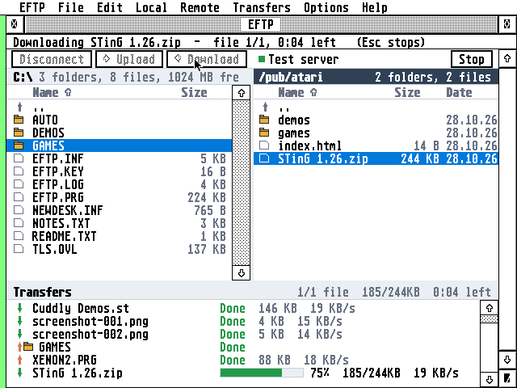
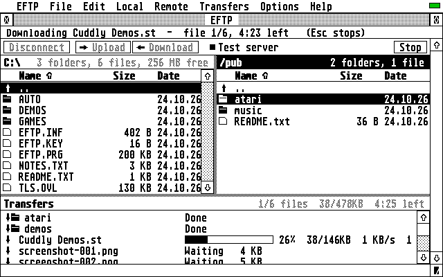
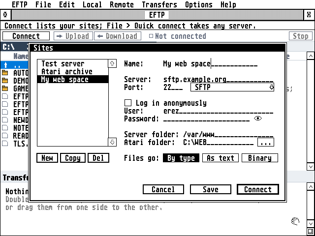
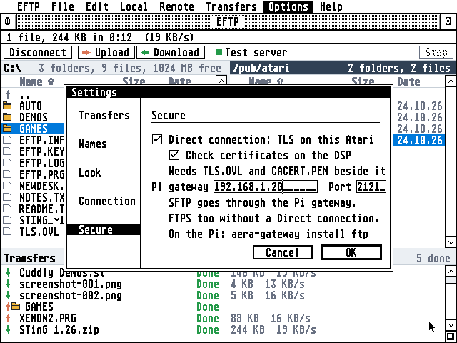

# EFTP


A two-pane FTP program for the Atari ST, STE, TT and Falcon, written in C for GEM, that reaches FTPS
and SFTP servers too.

**Highlights**

- **Two panes, like FileZilla:** this Atari's files on the left, the server's on the right, the
  transfers below, with dividers you can drag.
- **Whole folders, both ways:** a folder goes with everything in it, listed all the way down
  before the first file, so the list and the count are complete from the start.
- **Drag and drop** from one side to the other, or double-click, or **Upload** and **Download** in
  the toolbar.
- **A transfer queue** with a progress bar, the speed and the time left for the whole transfer; Done, Skipped, Stopped and
  Failed in colour, and why.
- **Resume:** Stop (Esc) and Retry go on where a file stopped (REST); when the line drops in the
  middle, EFTP connects again by itself.
- **A file already there:** ask, replace, resume, replace if older, or skip, for one file or all of
  them.
- **Names TOS can take:** long names come down as 8+3 (`screenshot-001.png` becomes `SCREEN~1.PNG`),
  always the same for the same folder; capitals go up in small letters; UTF-8 names.
- **Dates kept** both ways (MDTM, MFMT), in your time zone by name.
- **Text and binary:** texts go in ASCII mode by their extension.
- **Secure servers:** FTPS and SFTP through a Raspberry Pi on your home network, from any Atari; FTPS
  by a TT or Falcon itself in a Direct connection (TLS 1.2, RSA on the DSP), as in EMail and ECal.
- **Site Manager:** your servers with their logins (passwords encrypted in `EFTP.INF`), the folders
  to start in, anonymous logins; **Quick connect** for the others.
- **File management on both sides:** new folder, rename, delete (folders with what is in them), and
  permissions on the server (`chmod` with tick boxes).
- **Modern but Atari:** one window, a toolbar with tooltips, right-click menus, column titles that
  sort, colour on 16- and 256-colour screens, a Settings dialog with a sidebar, the server's
  messages in a log pane, iconify, help in EHypView or ST-Guide.
- **Hebrew** names, shown in the Atari character set; F10 switches to the Hebrew keyboard.
- **Small and quick:** one program for every Atari, about 200 KB of plain 68000 code, that runs on a
  1 MB ST with STinG; a TT or Falcon loads the TLS (`TLS.OVL`) only for a Direct connection. It runs
  in TT RAM when there is some.



## Getting started

Download what you need from the **[latest release](https://github.com/whomper/EFTP/releases/latest)**,
file by file or all together in the zip:

| File | What it is |
|---|---|
| `EFTP.PRG` | the program, for every ST, STE, TT and Falcon |
| `TLS.OVL` | the Direct connection (TLS on a TT or Falcon, RSA on the DSP), loaded only when used; an ST leaves it on the disk |
| `CACERT.PEM`, `ROOTS.DAT` | the root certificates for a Direct connection |
| `EFTP.HYP` | the user guide, for EHypView or ST-Guide; the Help key opens it |
| `EFTP.RSC`, `EFTPNV.RSC`, `EFTP.ICN`, `EFTPMK.ICN` | the desktop icon (in the zip's `icons/` folder): `EFTP.RSC` under TOS, EmuTOS, or NVDI with TOS's palette loaded (COLORVDI); `EFTPNV.RSC` under NVDI with its own palette |
| `EFTP-x.y.zip` | all of these together |

1. Copy `EFTP.PRG` into any folder, with `EFTP.HYP`; on a TT or Falcon, for a Direct connection,
   `TLS.OVL`, `CACERT.PEM` and `ROOTS.DAT` too. EFTP has no folder it must be in: it keeps its settings
   (`EFTP.INF`, `EFTP.KEY`) in the folder it is started from, so one of its own keeps them
   together. To update, copy a new release's files over these; the settings stay.
2. Load STinG (or run MiNT with MiNTnet).
3. Start EFTP, choose **File > Sites** (^K), make a site with the server's name and your login,
   and press **Connect**. Afterwards **Connect** in the toolbar lists your sites: one click
   connects.
4. Press **Help** in EFTP for the guide.

For FTPS and SFTP servers, see [How it reaches the servers](#how-it-reaches-the-servers). The
[user guide](docs/GUIDE.md) describes everything else.

**Needs:** TOS 1.04 or newer (TOS 4 on the Falcon), EmuTOS, MagiC or MiNT; 640×200 (ST medium) or
larger; free memory when it starts: about 350 KB, and about 140 KB more for a Direct connection,
which loads `TLS.OVL` (more makes downloads faster); network: STinG (or STiK) on plain TOS, MiNTnet
under FreeMiNT, or MagiC-Net. A Direct connection needs a 68020 or better: a TT or Falcon.

**With STinG, set the Delay in `STING.CPX` to suit the machine:** 10 on a
Falcon or TT, 25 to 50 on an ST, as STinG's manual says. STinG looks at the network card that
often, so it sets the speed of every STinG program: on Erez's Falcon with a NetUSBee, Delay 10
took EFTP's downloads from 40 to 75 KB/s. With a NetUSBee, also keep STinG's TCP receive window
small (5840 with an MSS of 1460): the card holds about four full packets.

**Under TOS, put Atari's `FOLDR100.PRG` first in `AUTO`**, renamed for more room (`FOLDR400.PRG`).
TOS keeps an entry in a small internal pool for every folder a program or accessory has looked
into, and halts with "OUT OF INTERNAL MEMORY" when it runs out; FOLDRxxx makes the pool bigger.



## How it reaches the servers

Plain FTP goes straight to the server from any Atari. For FTPS and SFTP, like
[EMail](https://github.com/whomper/EMail) and [ECal](https://github.com/whomper/ECal), EFTP goes one
of two ways:

```
ST, STE:     Atari (EFTP) --plain FTP, home LAN--> Raspberry Pi (eftpgate.py) --FTPS or SFTP--> the server
Falcon, TT:  Atari (EFTP + TLS.OVL: TLS 1.2, RSA on the DSP) --------------------------FTPS--> the server
             (a Direct connection; or through the Pi, as an ST)
```

SFTP always goes through the Pi, from a Falcon too, and so does FTPS without a Direct connection. EFTP
picks the way from the site's **Protocol** (**File > Sites**) and **Options > Settings > Secure**.

- **Through the Pi.** `gateway/eftpgate.py` is an FTP server for the Atari that speaks FTPS (Python's
  ftplib, resuming the TLS session on every data connection) or SFTP (paramiko) to the server named
  in the login, `sftp:user@host:port`; EFTP writes that for you from the site's Protocol. It checks
  certificates, remembers SSH host keys, and turns text files' line ends for SFTP.
  On the Pi, [AERA-Gateway](https://github.com/whomper/AERA-Gateway) sets it up as a service (below).
- **A Direct connection.** On a TT or Falcon, EFTP does FTPS itself with `TLS.OVL`, the family's
  TLS: [BearSSL](https://bearssl.org/) built for the 68030, the same TLS code as EMail and ECal
  (ChaCha20 first, RSA certificates checked on the DSP56001, sessions resumed); explicit (AUTH TLS) and implicit (port 990). Every data connection resumes the control
  connection's session, which saves the slow part of the handshake and which vsftpd and others
  insist on.

**Setting up the Pi** (Raspberry Pi OS bullseye or newer, from a fresh card), with your Atari's
address for `ATARI_IP`. The short way, one line that takes AERA-Gateway's latest release and sets up
the AERA gateways for that Atari (`aera-gateway install all`), EFTP's among them; EMail's needs
your mail servers after `--mail` (see [AERA-Gateway](https://github.com/whomper/AERA-Gateway)):

```sh
sudo apt install -y git && git clone https://github.com/whomper/AERA-Gateway ~/AERA-Gateway && ~/AERA-Gateway/update-pi.sh --allow ATARI_IP
```

Or step by step, with EFTP's gateway only:

```sh
sudo apt install -y git                          # Raspberry Pi OS Lite comes without it
git clone https://github.com/whomper/AERA-Gateway ~/AERA-Gateway
~/AERA-Gateway/update-pi.sh                      # the latest release; and aera-gateway a command
sudo aera-gateway install ftp --allow ATARI_IP
```

(`update-pi.sh` makes `aera-gateway` a command; before it has run once, it is
`~/AERA-Gateway/gateway/aera-gateway`.) To update: `~/AERA-Gateway/update-pi.sh`. To check:
`aera-gateway status`.

In EFTP: **Options > Settings > Secure**, Pi gateway `PI_IP` (the Pi's address), port **2121**.
Then give the sites their real server names and choose FTPS or SFTP as their Protocol in
**File > Sites**. For a server on your home network (a NAS, say), add `--allow-local` to the
install line.

The gateway's options, keeping it private and what to do when something doesn't work are in
its own README, [gateway/README.md](gateway/README.md). `gateway/` here is a copy of
AERA-Gateway's for EFTP's tests; set the Pi up from AERA-Gateway itself, as above.





## In more detail

- FTP as servers speak it today (RFC 959, 2389, 3659): FEAT, MLSD listings with exact sizes and UTC
  times, or LIST from older servers (Unix, Windows/IIS and `ls --time-style` formats), SIZE, MDTM,
  MFMT, REST, UTF8, EPSV with PASV as the fallback.
- Passive mode only: the Atari makes every connection itself, so it works from behind any router; a
  server that gives an address only its own network can reach is reached by the address it was
  found at.
- The window stays alive during a transfer: you can move windows, the progress shows, and Esc or the
  **Stop** button stops it.
- Keeps the line open while you look around (NOOP every minute), and offers to connect again if the
  server hangs up anyway.
- Hidden files on request, folders above files, sort by name, size or date.
- A protocol log (`EFTP.LOG`) with every line timed to the hundredth of a second and the passwords
  left out.
- `EFTP.INF` in capitals, each setting with a note above it and an empty line after it, as EMail's.
- The help: `EFTP.HYP` for EHypView or ST-Guide, opened by the Help key.

EFTP shares a lot with [EMail](https://github.com/whomper/EMail),
[ECal](https://github.com/whomper/ECal) and [ClaudeST](https://github.com/whomper/ClaudeST): the same
freestanding TOS runtime, GEM bindings and STinG client, the same window with panes, dialogs,
colours and Settings, and icons drawn the same way.

## Building

```sh
sudo apt install gcc-m68k-linux-gnu python3 zip   # Debian/Ubuntu; no MiNTLib needed
make                         # binary/EFTP.PRG, TLS.OVL (common's, as it is), ROOTS.DAT
make help HCP=/path/to/hcp   # binary/EFTP.HYP from docs/GUIDE.md
make dist                    # dist/: each of a release's files, and EFTP-x.y.zip
make icons                   # icons/: EFTP.RSC, EFTPNV.RSC, EFTP.ICN, EFTPMK.ICN
```

`make test` and `make itest` are under [Tests](#tests).

The ST-Guide help file `binary/EFTP.HYP` is made from `docs/GUIDE.md` by `tools/mkhelp.py` and the
HCP compiler from the [hypview](https://github.com/th-otto/hypview) project
(`common/tools/build-hcp.sh DIR` builds it).

**Versions and releases.** `binary/` and `dist/` are what make builds; they are never committed,
and a build changes no tracked file. `VERSION` holds the last release, major.minor (e.g. 1.40). Every
build shows it as it is in the About box: only releases leave the build machine. To
release: `tools/bump.py`, commit and push, then **Actions > Release > Run workflow** on `main` with
what is new. [`.github/workflows/release.yml`](.github/workflows/release.yml) tests, builds the
program and the help file, tags the commit `vX.Y` and publishes the files and the zip as a GitHub
Release with those notes. Pushing a tag `vX.Y` made with `git tag -a` does the same, with the tag's
message as the notes.

No MiNTLib is needed: the program is freestanding (its runtime is in `common/atari/`) and
`common/tools/elf2tos.py` writes the TOS executable. It is built for the 68000, so it runs on every
Atari from the ST to the Falcon. The TLS for a Direct connection is not in it: `TLS.OVL`, the
family's, is built in AERA-Atari from common's `tls.c` and BearSSL (`common/third_party/bearssl`)
for the 68030, and comes here with `common/` (`common/tlsovl/TLS.OVL`); `make` copies it next to
the program, never builds it. The tests on this computer link `tls.c` and BearSSL directly. `common/tools/mkroots.c` decodes `CACERT.PEM` (from `common/certs/`) into
`ROOTS.DAT`. The desktop icon is the family's: its drawing, in 256 colours, 16 and black and white,
is `common/icons/EFTP.txt` (change it in AERA-Atari), and `make icons` (`common/tools/appicon.py`)
makes `icons/`, `ui/icon.h`, `ui/icon16.h`, `ui/icon256.h` and the pictures in `docs/` from it.
`EFTPNV.RSC` is `EFTP.RSC` with its 256-colour image on NVDI's own 256 colours, which share only
4 with TOS's.

## Source

```
src/      the FTP core: the protocol and its listings (ftp.c), the transfer queue
          and names (xfer.c), settings and sites (store.c)
ui/       the GEM program: the window and its panes, the file lists, the transfers,
          dialogs, menus, the toolbar, fonts, colours, the About box
atari/    plat_tos.c: files, folders and time on GEMDOS
common/   code shared with the other AERA programs (from AERA-Atari): the TOS runtime
          (start-up, system calls, a small C library, AES/VDI, TCP over STinG/STiK
          or MiNTnet with a DNS client), the connection, TLS.OVL and its loader,
          charsets, time zones, the menu bar, help, drag and drop, BearSSL, the
          DSP RSA, bidi, dates, passwords, the root certificates, build tools
gateway/  the Raspberry Pi gateways (eftpgate.py is EFTP's) and aera-gateway, their installer:
          a copy of AERA-Gateway's; change it there, then run tools/sync-gateway.sh
tests/    unit, fuzz and integration tests, the Hatari test rig
tools/    the help builder, sync-common.sh, sync-gateway.sh, bump.py, add_to_emuicon.py
icons/    the desktop icon (RSC and ICN files), from make icons
docs/     the user guide (GUIDE.md, the source of EFTP.HYP) and pictures
binary/   what make builds for the Atari (not committed: the releases have it)
dist/     a release's files, from make dist (not committed)
```

## Tests

The FTP core (`src/`) also builds on Linux, where it is tested against a real FTP server before it
runs on the Atari:

```sh
make test     # listing parsers (Unix, DOS, MLSD), PASV/EPSV, 8+3 names, paths, text mode,
              # sorting; the fuzz inputs again (tests/fuzz/seeds)
make fuzz     # whole FTP sessions and listings from libFuzzer (clang),
              # the control and data connections each with their own part
make itest    # against pyftpdlib: logins, MLSD and LIST, files and folders both ways,
              # resume, text mode, UTF-8 names; FTPS with EFTP's own TLS (explicit,
              # implicit, RSA and ECDSA, sessions resumed, wrong certificates refused);
              # the gateway against an SFTP and an FTPS server
              # (pip install pyftpdlib pyopenssl paramiko; openssl on the PATH)
```

`tests/hatari/` runs EFTP itself in the [Hatari](https://hatari.tuxfamily.org/) emulator with
[EmuTOS](https://emutos.sourceforge.io/), with Xvfb and xdotool:

```sh
python3 tests/hatari/net_test.py /tmp/eftp-net Falcon              # a real FTP server; or ST-1, ST, TT
python3 tests/hatari/secure_test.py /tmp/eftp-sec Falcon           # Direct FTPS; SFTP via eftpgate; no TLS.OVL
python3 tests/hatari/esc_test.py /tmp/eftp-esc Falcon             # Esc and Undo cancel every dialog
python3 tests/hatari/disk_audit.py /tmp/eftp-disk Falcon          # disk access against its budgets (6.5)
python3 tests/hatari/clock_test.py /tmp/eftp-clock Falcon         # times right on a fast 200 Hz clock
python3 tests/hatari/font_test.py /tmp/eftp-font Falcon:16         # a GDOS font chosen, kept, drawn
python3 tests/hatari/field_test.py /tmp/eftp-field Falcon         # fields hold more than they show
python3 tests/hatari/screenshots.py /tmp/eftp-shots               # the pictures in docs/
```

The machines are the family's (`common/tools/machines.py list`): `ST-1` (1 MB), `ST`, `TT`, `Falcon`
and `Falcon-4`, all running `EFTP.PRG` with `TLS.OVL` next to it, with EmuTOS 1.4, which `machines.py` fetches, or
with your own TOS 1.04 and 4.04 when they are in `~/.aera/tos` (`AERA_TOS=emutos` for EmuTOS's).
`net_test.py` boots one, where EFTP connects from the
Site Manager, downloads a folder, uploads one by dragging it, answers "already there" with Skip, and
stops and resumes a download; the test checks every byte on both sides. After
`make -C common/tests/av` it also hands EFTP a file the way a desktop does (VA_START). Hatari has no
network card, so `FAKESTNG.PRG` (the family's, in `common/tools/fakesting/`) stands in for STinG and
carries EFTP's connections over the emulated serial port to `serial_bridge.py`; it's for the
emulator only, so never install it on a real Atari.
`disk_audit.py` counts EFTP's own GEMDOS calls in Hatari's trace for a 1 MB download, a 1 MB
upload, a folder of 20 files and a folder of 200 listed, and fails above the family's budget
(guidelines 6.5): one open a file, writes of 8 KB or more, reads of 16 KB or more, no lookup a file,
the dates right both ways, at most one Dfree a job.
`secure_test.py` does the same against secure servers: FTPS in a Direct connection (TLS.OVL, RSA on
the emulated DSP, every data connection resuming the TLS session) and SFTP through `eftpgate.py`,
and checks the files' bytes and line ends; then, without `TLS.OVL`, that switching a Direct
connection on says so in an alert and the log, and EFTP goes on.
`font_test.py` chooses the first monospaced GDOS font in Options > Font and checks that both panes
redraw in it, Hebrew file names too, that it is kept in `EFTP.INF` and that EFTP draws its folder
whole in it when started again. It needs a GDOS: with `AERA_WITH_NVDI=1`, `machines.py` installs
NVDI on the Falcon from your own copy (see its notes); without one it says so and passes.
`field_test.py` types, with the keyboard alone, more than the Site Manager's fields show: a user,
a password of 60 and a server folder, edited with ClrHome, Delete and Shift+Right, ^C ^V ^X;
then renames a server file to a name longer than its field. It checks `EFTP.INF`, the server's
login and folder, the clipboard and the new name (guidelines 5.4).

## Licence

EFTP is free software: you can redistribute it and/or modify it under
the terms of the GNU General Public License as published by the Free
Software Foundation, either version 2 of the License, or (at your option)
any later version. It is distributed in the hope that it will be useful,
but WITHOUT ANY WARRANTY; without even the implied warranty of
MERCHANTABILITY or FITNESS FOR A PARTICULAR PURPOSE. See [COPYING](COPYING).

Copyright (C) 2026 AERA | Erez Yaary.

It includes, under their own licences (compatible with the GPL):

- [BearSSL](common/third_party/bearssl) by Thomas Pornin: MIT licence
  ([LICENSE.txt](common/third_party/bearssl/LICENSE.txt))
- `CACERT.PEM`, the root certificates for a Direct connection, from Mozilla's CA
  list (Mozilla Public License 2.0)

The gateway uses [paramiko](https://www.paramiko.org/) for SFTP (LGPL 2.1), installed on the Pi
(Raspberry Pi OS: `python3-paramiko`) and not part of this repository.

---

Part of **AERA** for Atari: [ECal](https://github.com/whomper/ECal) · [EContact](https://github.com/whomper/EContact) · [EMail](https://github.com/whomper/EMail) · [EFTP](https://github.com/whomper/EFTP) · [EHypView](https://github.com/whomper/EHypView) · [ClaudeST](https://github.com/whomper/ClaudeST) · [EWeb](https://github.com/whomper/EWeb) · [EUpdate](https://github.com/whomper/EUpdate) · 8-bit: [EDOS](https://github.com/whomper/EDOS) · [EFTP_XL](https://github.com/whomper/EFTP_XL) · Pi: [AERA-Gateway](https://github.com/whomper/AERA-Gateway)
