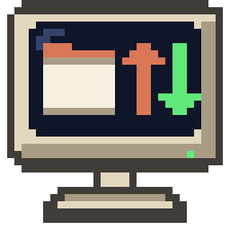

# EFTP



An FTP program for the Atari ST, STE, TT and Falcon, written in C for
GEM. Files and whole folders go between your Atari and an FTP server,
both ways, the way a modern FTP program does it.


**Highlights**

- **Two panes, like FileZilla:** this Atari's files on the left, the
  server's on the right, the transfers below, with draggable dividers
- **Whole folders, both ways:** a folder is copied with everything in
  it, folder by folder
- **Drag and drop** from one side to the other, or double-click, or
  Upload and Download in the toolbar
- **A transfer queue** with a progress bar, the speed and the time left;
  Done, Skipped, Stopped and Failed in colour, and why
- **Resume:** Stop (Esc) and Retry go on where a file stopped (REST);
  when the line goes in the middle, EFTP connects again by itself
- **A file already there:** ask, replace, resume, replace if older, or
  skip, for one file or all of them
- **Names TOS can take:** long names come down as 8+3 (`screenshot-001.png`
  becomes `SCREEN~1.PNG`), always the same for the same folder; capitals
  go up in small letters; UTF-8 and Hebrew names
- **Dates kept** both ways (MDTM, MFMT), in your time zone by name
- **Text and binary:** texts go in ASCII mode by their extension
- **Site Manager:** your servers with their logins (passwords encrypted
  in EFTP.INF), the folders to start in, anonymous logins; Quick connect
  for the others
- **File management on both sides:** new folder, rename, delete (folders
  with what is in them), permissions on the server (`chmod` with tick
  boxes)
- **Modern but Atari:** one window, a toolbar with tooltips, right-click
  menus, column titles that sort, colour on 16- and 256-colour screens,
  a Settings dialog with a sidebar, the server's messages in a log pane
- **Small and quick:** 140 KB, plain 68000 code: runs on a 1 MB ST
  with STinG, and in TT RAM when there is some
- Runs on TOS 1.04 to 4.x, EmuTOS, MagiC and MiNT, with STinG or
  MiNTnet, from an ST in medium resolution to a Falcon in 640×480


**In more detail**

- FTP as servers speak it today (RFC 959, 2389, 3659): FEAT, MLSD
  listings with exact sizes and UTC times, or LIST from older servers
  (Unix, Windows/IIS and `ls --time-style` formats), SIZE, MDTM, MFMT,
  REST, UTF8, EPSV with PASV as the fallback
- Passive mode only: the Atari makes every connection itself, so it
  works from behind any router; a server that gives an address only its
  own network can reach is reached by the address it was found at
- The window stays alive during a transfer: windows can be moved, the
  progress shows, Esc or the Stop button stops it
- Keeps the line open while you look around (NOOP every minute), and
  offers to connect again if the server hangs up anyway
- Hidden files on request, folders above files, sort by name, size or
  date
- A protocol log (EFTP.LOG) with every line timed to the hundredth of a
  second and the passwords left out
- EFTP.INF in capitals, each setting with a note above it, as EMail's
- The help: EFTP.HYP for ST-Guide, opened by the Help key


EFTP is part of a family with [EMail](https://github.com/whomper/EMAIL),
[ECal](https://github.com/whomper/ECal) and
[Claude ST](https://github.com/whomper/ClaudeST): the same freestanding
TOS runtime, GEM bindings and STinG client, the same window with panes,
dialogs, colours and Settings, and the same monitor on the icon.

## Getting started

Everything to copy to the Atari is in [`binary/`](binary): `EFTP.PRG`,
`EFTP.HYP` (the user guide for ST-Guide, opened by the Help key), and
the desktop icon in `binary/icons/`.

1. Copy `EFTP.PRG` (and `EFTP.HYP`) into a folder of its own, e.g.
   `C:\EFTP\`.
2. Load STinG (or run MiNT with MiNTnet).
3. Start EFTP, press Connect (^K), make a site with the server's name
   and your login, and Connect.

The [user guide](docs/GUIDE.md) describes everything else.


## Building

```
sudo apt install gcc-m68k-linux-gnu      # Debian/Ubuntu
make                                     # writes binary/EFTP.PRG
```

Every build of EFTP.PRG gets the next version: the Makefile counts up the
minor number in `VERSION` (major.minor) each time it links the program;
it shows in the About box. Commit `VERSION` together with the program.

The ST-Guide help file `binary/EFTP.HYP` is made from `docs/GUIDE.md` by
`tools/mkhelp.py` and the HCP compiler from the
[hypview](https://github.com/th-otto/hypview) project:
`make help HCP=/path/to/hcp`.

No MiNTLib is needed: the program is freestanding (`atari/`) and
`tools/elf2tos.py` writes the TOS executable. It is built for the 68000,
so it runs on every Atari from the ST to the Falcon. The desktop icon is
drawn by `tools/icon/make_icon.py` (which also writes `ui/icon.h`,
`ui/icon16.h` and the previews in `docs/`) and `tools/icon/make_rsc.py`.

## Source

```
atari/   TOS runtime: start-up, system calls, a small C library, AES/VDI,
         TCP over STinG/STiK or MiNTnet (with a DNS client)
src/     the FTP core: the protocol and its listings (ftp.c), the
         transfer queue and names (xfer.c), settings and sites (store.c),
         the connection (conn.c), charsets, time zones
ui/      the GEM program: the window and its panes, the file lists, the
         transfers, dialogs, menus, the toolbar
tests/   unit and integration tests, the Hatari test rig
tools/   elf2tos.py, the icon generator, the help builder,
         FAKESTNG.PRG (for testing in Hatari only)
binary/  what goes on the Atari: EFTP.PRG, EFTP.HYP and the desktop icon
```

## Tests

The FTP core (`src/`) also builds on Linux, where it is tested against a
real FTP server before it runs on the Atari:

```
make test           # listing parsers (Unix, DOS, MLSD), PASV/EPSV, 8+3 names, sorting
make itest          # against pyftpdlib: logins, MLSD and LIST, files and folders
                    # both ways, resume, text mode, UTF-8 names (pip install pyftpdlib)
```

`tests/hatari/` runs EFTP.PRG itself in the
[Hatari](https://hatari.tuxfamily.org/) emulator with
[EmuTOS](https://emutos.sourceforge.io/), with Xvfb and xdotool:

```
make -C tools/fakesting
tests/hatari/net_test.py /tmp/eftp-net etos512us.img       # Falcon, a real FTP server
tests/hatari/screenshots.py /tmp/eftp-shots etos512us.img  # the pictures in docs/
```

`net_test.py` boots an emulated Falcon with 1 MB, where EFTP connects
from the Site Manager, downloads a folder, uploads one by dragging it,
answers "already there" with Skip, and stops and resumes a download; the
test checks every byte on both sides. Hatari has no network card, so
`FAKESTNG.PRG` stands in for STinG and carries EFTP's connections over
the emulated serial port to `serial_bridge.py`. It's for the emulator
only; never install it on a real Atari.
